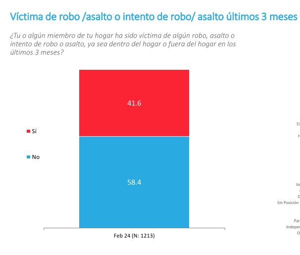
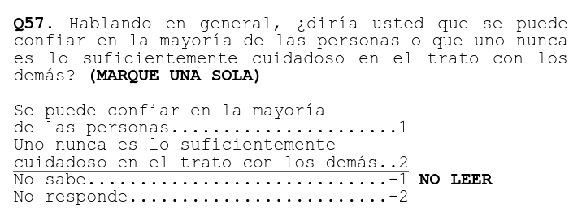
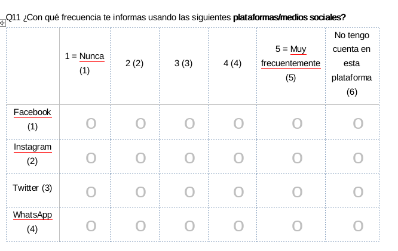
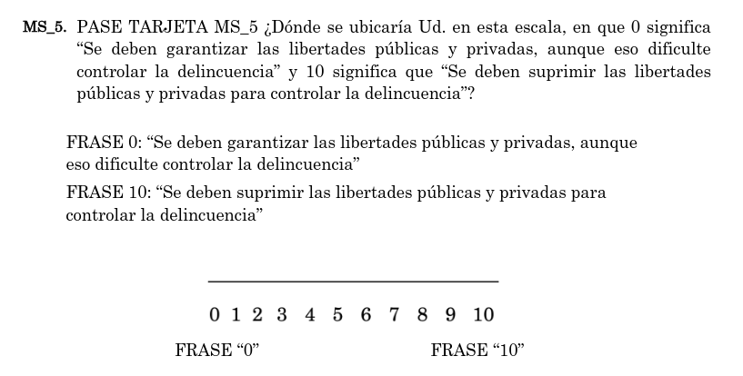
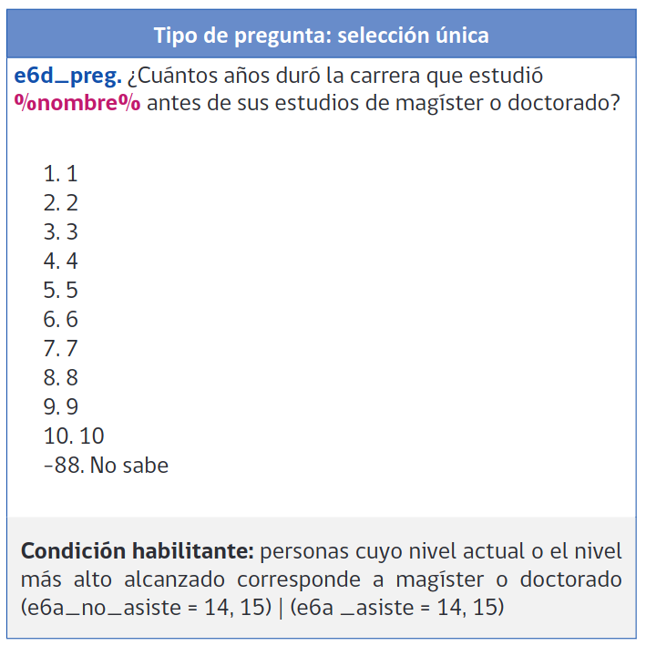
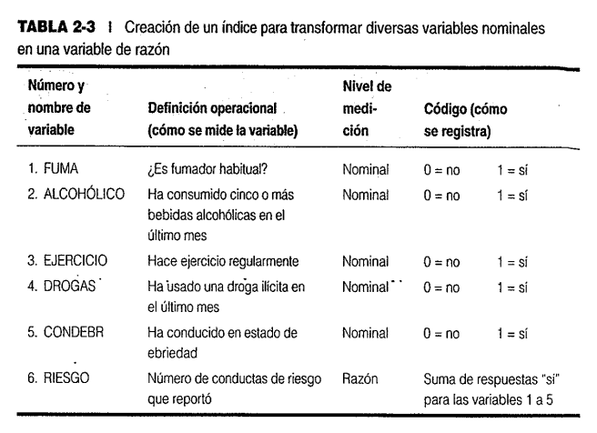
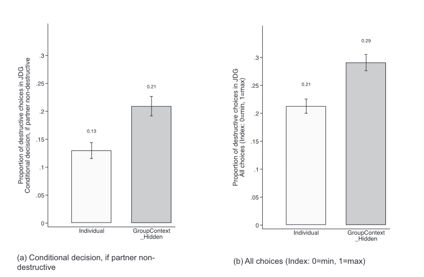

class: left, middle, bg_portada
```{r setup, include=FALSE}
options(htmltools.dir.version = FALSE)
knitr::opts_chunk$set(
  fig.width=9, fig.height=3.5, fig.retina=3,
  out.width = "100%",
  cache = FALSE,
  echo = FALSE,
  message = FALSE,
  warning = FALSE,
  hiline = TRUE
)
```
```{r xaringan-themer, include=FALSE, warning=FALSE}
library(xaringanthemer)
style_duo_accent(
  primary_color = "#b01333",
  secondary_color = "#085e9f",
  inverse_header_color = "#FFFFFF"
)
```
```{css, echo=F}
h1, h2, h3 {
  text-align: center;
}
.bg_portada {
  position: relative;
  z-index: 1;
}
.bg_portada::before {
  content: "";
  background-image: url('https://www.infoworld.com/wp-content/uploads/2024/06/cw_r_guide_video_series_thinkstock_16x9_1920x1080-100758020-orig.jpg?quality=50&strip=all');
  background-size: cover;
  background-position: center;
  position: absolute;
  top: 0px; right: 0px; bottom: 0px; left: 0px;
  opacity: 0.15;
  z-index: -1;
}
.definition-box {
  background: #fdf2f3;
  border-left: 5px solid #b01333;
  border-radius: 0 8px 8px 0;
  padding: 14px 18px;
  margin: 10px 0;
  font-size: 0.88em;
}
.highlight-box {
  background: #fef9e7;
  border: 2px solid #f39c12;
  border-radius: 8px;
  padding: 12px 16px;
  margin: 12px 0;
  font-size: 0.85em;
}
.info-box {
  background: #eaf2fb;
  border-left: 5px solid #085e9f;
  border-radius: 0 8px 8px 0;
  padding: 12px 16px;
  margin: 12px 0;
  font-size: 0.85em;
}
.two-col {
  display: grid;
  grid-template-columns: 1fr 1fr;
  gap: 20px;
  align-items: center;
}
.three-col {
  display: grid;
  grid-template-columns: 1fr 1fr 1fr;
  gap: 16px;
}
.card {
  background: white;
  border-radius: 10px;
  padding: 14px;
  box-shadow: 0 2px 8px rgba(176,19,51,0.12);
  font-size: 0.84em;
}
.card-red   { border-top: 4px solid #b01333; }
.card-blue  { border-top: 4px solid #085e9f; }
.card-green { border-top: 4px solid #1e8449; }
.card-orange{ border-top: 4px solid #e67e22; }
.badge {
  display: inline-block;
  background: #b01333;
  color: white;
  border-radius: 20px;
  padding: 3px 12px;
  font-size: 0.78em;
  font-weight: bold;
  margin-right: 6px;
}
.badge-blue  { background: #085e9f; }
.badge-green { background: #1e8449; }
.step {
  display: flex;
  align-items: flex-start;
  margin-bottom: 10px;
  gap: 12px;
}
.step-num {
  background: #b01333;
  color: white;
  border-radius: 50%;
  width: 28px; height: 28px;
  display: flex;
  align-items: center;
  justify-content: center;
  font-weight: bold;
  flex-shrink: 0;
  font-size: 0.9em;
}
.footnote-small {
  font-size: 0.68em;
  color: #777;
  border-top: 1px solid #DDD;
  padding-top: 6px;
  margin-top: 6px;
}
table { font-size: 0.78em; width: 100%; border-collapse: collapse; }
th { background: #b01333; color: white; padding: 7px 10px; text-align: left; }
td { padding: 6px 10px; border-bottom: 1px solid #e0e0e0; }
tr:nth-child(even) { background: #f5f7fa; }
blockquote {
  border-left: 4px solid #b01333;
  background: #fdf2f3;
  padding: 10px 16px;
  border-radius: 0 8px 8px 0;
  font-style: italic;
  color: #333;
  margin: 10px 0;
  font-size: 0.90em;
}
img { border-radius: 8px; box-shadow: 0 2px 8px rgba(0,0,0,0.15); }
```


---
class: left, middle, bg_portada
# Tecnología para la Gestión II
## Clase 4 — Repaso: tipos de variables y filtrado
**Francisco Villarroel Riquelme** | `r Sys.Date()`

.footnote-small[Administración Pública · Escuela de Gobierno · Facultad de Economía y Gobierno · ADPU B012]

---
class: middle

# ¿Qué haremos hoy?

.definition-box[
Hoy es una clase de **repaso y reforzamiento**. Volvemos sobre lo que más cuesta, con hartos casos prácticos para afianzarlo.
]

.two-col[
.info-box[
**Bloque 1 — Repaso**
- Tipos de variables (mirada conceptual)
- Del tipo conceptual al tipo en R
- Filtrado con `filter()` y operadores lógicos
- Ejercicios guiados y para ustedes
]
.info-box[
**Bloque 2 — A lápiz y papel**
- Escribir un script **a mano**, de principio a fin
- Desde instalar paquetes hasta transformar una variable
]
]

---
class: center, middle, inverse

# Bloque 1

# Repaso de tipos de variables

---
class: middle

# ¿Por qué volver sobre los tipos?

.definition-box[
En la clase pasada **reclasificamos** columnas mal cargadas. Hoy entendemos el **porqué conceptual**: qué tipo de variable es cada cosa antes de decirle a R cómo tratarla.
]

--
<br>
<br>
<br>

.highlight-box[
Clasificar bien no es un detalle técnico: **decide qué análisis puedes hacer**. Un promedio sobre una variable nominal no significa nada; un orden sobre categorías sin jerarquía, tampoco.
]

---
background-image: url(https://upload.wikimedia.org/wikipedia/commons/c/c4/Logo_Universidad_san_sebastian.png)
background-size: 80px
background-position: 97% 97%
class: middle

# Dos grandes familias

.two-col[
.card.card-red[
**Cualitativas** (categorías)

- **Nominal:** categorías sin orden (comuna, sexo, signo zodiacal).
- **Ordinal:** categorías con orden, pero sin distancia definida (Likert, prioridad).
]
.card.card-blue[
**Cuantitativas** (números)

- **Discreta:** conteos, solo enteros (n.º de hijos, visitas).
- **Continua / de razón:** admite decimales (ingreso, índices 0–1).
]
]

--

.info-box[
Regla rápida: si puedes **contar categorías**, es cualitativa; si puedes **hacer cuentas** (sumar, promediar), es cuantitativa.
]

---
class: left, top

## Cualitativa nominal (o categórica)

.two-col[


.definition-box[
- Categorías, clases o tipos **sin jerarquía**.
- No admiten puntuaciones numéricas ordenadas.
- Existen en versión **dicotómica** (sí / no) o de **categorías múltiples**.
- A veces se codifican con números en la base, pero ese número **no significa magnitud**.
]
]

---
class: left, top

## Nominal de categorías múltiples

.two-col[


.definition-box[
- Varias categorías, todas al mismo nivel: ninguna es "más" que otra.
- Ej.: comuna, tipo de solicitud, oficina municipal.
- En R viven como **`character`** o, mejor para analizar, como **`factor`**.
]
]

<br>
<br>
<br>
<br>


.footnote-small[Aunque se ordenen visualmente en un gráfico, entre las categorías no hay jerarquía real.]

---
class: left, top

## Cualitativa ordinal

.two-col[


.definition-box[
- Son categorías, pero con **orden interno** y jerarquía clara.
- No son numéricas: **no hay una distancia definida** entre categorías.
- ¿Cuánta diferencia real hay entre "de acuerdo" y "muy de acuerdo"?
- Versiones clásicas: **escalas Likert** y **escalas de polaridad**.
]
]

---
class:left, top

## Ordinal: escalas de polaridad

.two-col[


.info-box[
Las escalas 0–10 (o de un polo a otro) ordenan las respuestas de menor a mayor, pero **el paso de 3 a 4 no es necesariamente igual** al de 8 a 9. Por eso siguen siendo **ordinales**, no numéricas.
]
]

---
class:left, top

## Cuantitativa continua o de razón

.two-col[
.definition-box[
- Variable numérica que **incluye decimales**; puede ir de $-\infty$ a $+\infty$.
- También es de razón una versión **continua entre 0 y 1** (un índice).
- Suelen ser **sintéticas** (ej.: un índice de capital social, centralidad de red).
- Es la que **más versatilidad y precisión** entrega para cálculos estadísticos.
]
.card.card-blue[
**Ejemplos**
- Ingreso del hogar (CLP)
- Índice de desarrollo (0 a 1)
- Puntaje de satisfacción (1,0 a 7,0)
- Monto asignado a una solicitud
]
]

---
class:left, top

## Cuantitativa discreta

.two-col[


.definition-box[
- Variables que solo contemplan **números enteros**.
- Suelen surgir de **conteos**.
- Para los cálculos estadísticos se comportan casi como las de razón.
- Ej.: puntaje PAES, n.º de hijos, n.º de beneficiarios, días de tramitación.
]
]

---
class: center, middle

## De una nominal/dicotómica… a una de razón

.two-col[



]

.info-box[
Varias variables **dicotómicas** (sí/no = 1/0) se pueden **sumar o promediar** para construir un **índice** de razón. Así, "¿fuma?", "¿bebe?", "¿maneja ebrio?"… se combinan en un índice de conductas de riesgo, o en una **proporción** entre 0 y 1.
]

---
class: center, middle, inverse

# Del tipo conceptual… al tipo en R

---
class: middle

# Tabla puente: metodología ↔ R

<table>
<tr><th>Tipo de variable (metodología)</th><th>Tipo en R</th><th>Cómo se declara</th></tr>
<tr><td>Nominal / categórica</td><td><code>character</code> o <code>factor</code></td><td><code>as.character()</code> · <code>as.factor()</code></td></tr>
<tr><td>Dicotómica (sí / no)</td><td><code>logical</code> o <code>factor</code> (2 niveles)</td><td><code>as.logical()</code> · <code>== "Sí"</code></td></tr>
<tr><td>Ordinal</td><td><code>factor</code> ordenado</td><td><code>factor(x, levels =, ordered = TRUE)</code></td></tr>
<tr><td>Discreta (conteo)</td><td><code>integer</code></td><td><code>as.integer()</code></td></tr>
<tr><td>Continua / de razón</td><td><code>double / numeric</code></td><td><code>as.numeric()</code></td></tr>
<tr><td>Fecha</td><td><code>Date</code></td><td><code>as.Date()</code></td></tr>
</table>

<br>
<br>

.highlight-box[
El puente es siempre el mismo: **primero pienso qué tipo de variable es** (conceptual), **después le digo a R** con qué clase tratarla.
]
---
class: middle

# Ejercicio: "Ejemplos de variables"

Para cada variable: ¿qué tipo es?, ¿qué clase en R le corresponde?, ¿con qué comando la declaramos?

<table>
<tr><th>Variable</th><th>Tipo de variable</th><th>Tipo en R</th><th>Comando</th></tr>
<tr><td>Fechas (día-mes-año)</td><td>Temporal</td><td><code></code></td><td><code></code></td></tr>
<tr><td>Signo zodiacal</td><td>Cualitativa nominal</td><td><code></code></td><td><code></code></td></tr>
<tr><td>Índice de capital social (0 a 1)</td><td>Cuantitativa continua / razón</td><td><code></code></td><td><code></code></td></tr>
<tr><td>Rating</td><td>Cualitativa ordinal</td><td><code>factor</code> ord.</td><td><code></code></td></tr>
<tr><td>N.º de visitas a un artículo</td><td>Cuantitativa discreta</td><td><code></code></td><td><code></code></td></tr>
<tr><td>Hashtags</td><td>Cualitativa nominal (texto)</td><td><code>character</code></td><td><code></code></td></tr>
<tr><td>Cantidad de hijos en un hogar</td><td>Cuantitativa discreta</td><td><code></code></td><td><code></code></td></tr>
</table>


---
class: middle

# Ejercicio: "Ejemplos de variables"

Para cada variable: ¿qué tipo es?, ¿qué clase en R le corresponde?, ¿con qué comando la declaramos?

<table>
<tr><th>Variable</th><th>Tipo de variable</th><th>Tipo en R</th><th>Comando</th></tr>
<tr><td>Fechas (día-mes-año)</td><td>Temporal</td><td><code>Date</code></td><td><code>as.Date()</code></td></tr>
<tr><td>Signo zodiacal</td><td>Cualitativa nominal</td><td><code>character</code></td><td><code>as.character()</code></td></tr>
<tr><td>Índice de capital social (0 a 1)</td><td>Cuantitativa continua / razón</td><td><code>numeric</code></td><td><code>as.numeric()</code></td></tr>
<tr><td>Rating</td><td>Cualitativa ordinal</td><td><code>factor</code> ord.</td><td><code>factor(x, ordered = TRUE)</code></td></tr>
<tr><td>N.º de visitas a un artículo</td><td>Cuantitativa discreta</td><td><code>integer/numeric</code></td><td><code>as.numeric()</code></td></tr>
<tr><td>Hashtags</td><td>Cualitativa nominal (texto)</td><td><code>character</code></td><td><code>as.character()</code></td></tr>
<tr><td>Cantidad de hijos en un hogar</td><td>Cuantitativa discreta</td><td><code>integer/numeric</code></td><td><code>as.numeric()</code></td></tr>
</table>

<br>
<br>
.footnote-small["Rating" puede ser ordinal (una puntuación en escala); si fuera un rating continuo de audiencia, sería `numeric`. El contexto manda.]

---
class: center, middle

# Repaso

# Filtrado con `filter()`

---
class: middle

# `filter()` — recordatorio

Selecciona **filas** (observaciones) que cumplen una condición:

```r
gestion %>% dplyr::filter(comuna == "Maipú")
```

.definition-box[
`filter()` conserva las filas donde la condición es **verdadera** (`TRUE`) y descarta el resto. La clave está en **escribir bien la condición**, y para eso usamos los operadores lógicos.
]

---
class: middle

# Operadores lógicos, en detalle

<table>
<tr><th>Operador</th><th>Significado</th><th>Ejemplo</th></tr>
<tr><td><code>==</code></td><td>es igual a</td><td><code>comuna == "Renca"</code></td></tr>
<tr><td><code>!=</code></td><td>es distinto de</td><td><code>estado != 4</code></td></tr>
<tr><td><code>&gt;</code> &nbsp; <code>&lt;</code></td><td>mayor / menor que</td><td><code>monto_asignado &gt; 1e7</code></td></tr>
<tr><td><code>&gt;=</code> &nbsp; <code>&lt;=</code></td><td>mayor o igual / menor o igual</td><td><code>n_beneficiarios &gt;= 100</code></td></tr>
<tr><td><code>&amp;</code></td><td>Y (deben cumplirse ambas)</td><td><code>A &amp; B</code></td></tr>
<tr><td><code>|</code></td><td>O (basta con una)</td><td><code>A | B</code></td></tr>
<tr><td><code>!</code></td><td>negación (no)</td><td><code>!requiere_visita</code></td></tr>
<tr><td><code>%in%</code></td><td>está contenido en…</td><td><code>comuna %in% c("Maipú","Renca")</code></td></tr>
</table>

.footnote-small[Con paréntesis agrupamos condiciones: `(A | B) & C`. Basado en *AnalizaR Datos Políticos*.]

---
class: middle

# Cinco ejemplos, de menos a más

.info-box[
**Ejemplo 1** .badge-blue[1 operador] — solicitudes de la comuna de Maipú.
```r
gestion %>% dplyr::filter(comuna == "Maipú")
```
]

.info-box[
**Ejemplo 2** .badge-blue[1 operador] — solicitudes con monto sobre 20 millones.
```r
gestion %>% dplyr::filter(monto_asignado > 20000000)
```
]

---
class: middle

# Cinco ejemplos, de menos a más

.info-box[
**Ejemplo 3** .badge-blue[2 operadores] — prioridad Alta **y** ya resueltas.
```r
gestion %>% dplyr::filter(nivel_prioridad == "Alta" & estado == 3)
```
]

.info-box[
**Ejemplo 4** .badge-blue[2 operadores] — de Obras o Tránsito **y** que requieran visita.
```r
gestion %>% dplyr::filter(
  oficina_municipal %in% c("Dirección de Obras Municipales",
                           "Dirección de Tránsito") &
  requiere_visita == "Sí")
```
]

---
class: middle

# Cinco ejemplos, de menos a más

.definition-box[
**Ejemplo 5** .badge[3 operadores] — de persona natural **o** empresa, con prioridad Alta **y** monto sobre 5 millones.
```r
gestion %>% dplyr::filter(
  (tipo_solicitante == "Persona natural" | tipo_solicitante == "Empresa") &
  nivel_prioridad == "Alta" &
  monto_asignado > 5000000)
```
]

.highlight-box[
Fíjate en los **paréntesis** del Ejemplo 5: primero se resuelve el `O` de adentro, y ese resultado se combina con los dos `Y`. Sin paréntesis, R podría entender otra cosa.
]

---
class: middle

# Ahora ustedes .badge[10 ejercicios]

Escriban el `filter()` para obtener:

.two-col[
.info-box[
1. Solicitudes de la comuna de **Providencia**.
2. Solicitudes con **más de 1.000 beneficiarios**.
3. Solicitudes en estado **Resuelta** (`estado == 3`).
4. Solicitudes de prioridad **Media** que **requieran visita**.
5. Solicitudes de **La Florida** con monto **mayor a 10 millones**.
]
.info-box[
6. Solicitudes que **no** sean de persona natural.
7. Solicitudes de **Maipú, Puente Alto o La Pintana**.
8. Prioridad **Alta**, **en proceso** y que **requieran visita**.
9. De **Aseo y Ornato** o **Obras**, con **más de 500 beneficiarios**.
10. De **persona natural**, prioridad **Alta**, con monto **entre 5 y 20 millones**.
]
]

.footnote-small[La pauta está al final de la presentación.]

---
class: center, middle, inverse

# Bloque 2

# A lápiz y papel

---
class: middle

# El desafío

.definition-box[
En la Municipalidad te piden dejar listo un **script base**. En una hoja, y **sin computador**, escribe a mano el código completo que haga lo siguiente:
]

<div class="step"><div class="step-num">1</div><div><b>Instale y active</b> los paquetes necesarios.</div></div>
<div class="step"><div class="step-num">2</div><div><b>Cargue</b> <code>gestion_municipal.csv</code> desde la carpeta <code>data/</code> en un objeto llamado <code>gestion</code>.</div></div>
<div class="step"><div class="step-num">3</div><div><b>Muestre un vistazo</b> general de la base.</div></div>
<div class="step"><div class="step-num">4</div><div><b>Reclasifique</b> <code>nivel_prioridad</code> a <b>factor ordenado</b> (Baja → Media → Alta).</div></div>
<div class="step"><div class="step-num">5</div><div><b>Cree</b> la variable <code>prioridad_urgente</code>: <code>TRUE</code> si la prioridad es Alta <b>y</b> el estado no es rechazado.</div></div>

---
class: middle

# Cómo enfrentarlo

.info-box[
Piensa el script como una **receta ordenada**. Escribe una línea por paso y, al lado, un comentario con `#` que explique qué hace. No importa si algún nombre de función no te sale exacto: lo importante es la **lógica y el orden**.
]

.definition-box[
Preguntas guía mientras escribes:
- ¿Qué se hace **una sola vez** (instalar) y qué **cada vez** (activar)?
- ¿La ruta al archivo es **relativa** a la carpeta del proyecto?
- Para el paso 5, ¿qué **operadores lógicos** necesito para "Alta **y** no rechazado"?
]

.footnote-small[Tienen ~15 minutos. Después revisamos juntos en la pizarra.]

---
class: center, middle

# ¡Buen trabajo!

### La próxima clase: transformación de variables (Parte II)
Más recodificación, `ifelse()`, resúmenes por grupo y valores perdidos (`NA`).

.footnote-small[Dudas: fvillarroelr1@docente.uss.cl · Tecnología para la Gestión II · ADPU B012]

---
class: middle

# Pauta — 10 ejercicios .badge[solo docente]

.two-col[
.info-box[
```r
# 1
filter(comuna == "Providencia")
# 2
filter(n_beneficiarios > 1000)
# 3
filter(estado == 3)
# 4
filter(nivel_prioridad == "Media" &
       requiere_visita == "Sí")
# 5
filter(comuna == "La Florida" &
       monto_asignado > 10000000)
```
]
.info-box[
```r
# 6
filter(tipo_solicitante != "Persona natural")
# 7
filter(comuna %in% c("Maipú","Puente Alto",
                     "La Pintana"))
# 8
filter(nivel_prioridad == "Alta" &
       estado == 2 & requiere_visita == "Sí")
# 9
filter((oficina_municipal == "Dirección de Aseo y Ornato" |
        oficina_municipal == "Dirección de Obras Municipales") &
       n_beneficiarios > 500)
# 10
filter(tipo_solicitante == "Persona natural" &
       nivel_prioridad == "Alta" &
       monto_asignado > 5000000 &
       monto_asignado < 20000000)
```
]
]

.footnote-small[Todos anteponiendo `gestion %>% dplyr::` . Elimina esta diapositiva antes de proyectar si no quieres mostrar la pauta.]

---
class: middle

# Pauta — Bloque 2 (a lápiz y papel) .badge[solo docente]

.info-box[
```r
# 1) Paquetes
install.packages("tidyverse")   # una sola vez
library(tidyverse)              # cada vez

# 2) Cargar la base
gestion <- read.csv("data/gestion_municipal.csv")

# 3) Vistazo general
glimpse(gestion)

# 4) Reclasificar a factor ordenado
gestion$nivel_prioridad <- factor(gestion$nivel_prioridad,
                                  levels = c("Baja", "Media", "Alta"))

# 5) Crear variable lógica con operadores
gestion <- gestion %>%
  dplyr::mutate(prioridad_urgente = nivel_prioridad == "Alta" & estado != 4)
```
]

.footnote-small[Se acepta cualquier variante equivalente (p. ej. `case_when()` en el paso 5). Lo central: orden, rutas relativas y uso correcto de `&`.]
